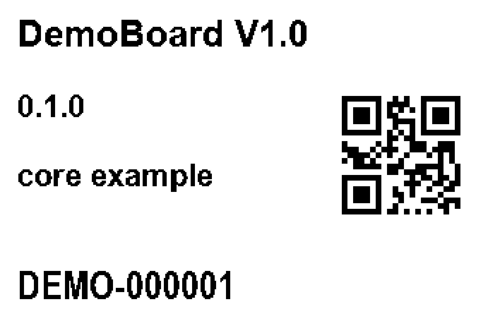

# NIIMBOT AI Printer · v1.0.0

一个可独立安装的非官方 Agent Skill：离线制作、预览设备 ID 二维码标签，通过 USB 或 macOS 原生 BLE 桥检查和打印 NIIMBOT B1 Pro。技能标准名称为 `niimbot-label`，根目录直接包含 `SKILL.md`。

**兼容性边界：只验证 NIIMBOT B1 Pro、macOS、300dpi、30×20mm、单份。其他品牌、型号和平台未验证，不视为支持。** 不依赖 NIIMBOT 厂商 App，不修改打印机固件，不绕过系统授权。

> Unofficial, self-contained Agent Skill for NIIMBOT B1 Pro. Offline device-label rendering, USB printing and a native macOS BLE bridge. Only B1 Pro on macOS with 300dpi, 30×20mm stock and one copy has been tested. Other models, brands and platforms are unverified. No vendor app dependency.



图中设备与版本全为虚构，二维码只编码 `DEMO-000001`。原生栅格见 [label-30x20mm.png](assets/label-30x20mm.png)。样图不代表真实设备、业务或打印验收。

## 安装为 Codex Skill

需要 Git、Python 3.9+。公开后可使用下面的仓库地址安装。目标目录必须不存在，避免覆盖其他已安装版本。

```sh
mkdir -p "$HOME/.codex/skills"
git clone "https://github.com/zhoushoujianwork/niimbot-ai-skill.git" "$HOME/.codex/skills/niimbot-label"
cd "$HOME/.codex/skills/niimbot-label"
python3 -m venv .venv
source .venv/bin/activate
python3 -m pip install -r requirements.txt
```

克隆目标 `niimbot-label` 这一个目录中直接包含 `SKILL.md`，不要再套一层仓库文件夹。重新打开或刷新 Codex 的技能发现后，可使用 `$niimbot-label`。下面所有 Python 命令均使用激活后的 venv `python3`；BLE 启动器通过 `#!/usr/bin/env python3` 继承该环境。

依赖范围以当前已检查版本为依据，详见 [requirements.txt](requirements.txt)。这是兼容范围，不是锁定全部传递依赖的 lockfile；未知 Python/包组合需自行验证。无需安装厂商 App 或 Bleak。字体由系统合法安装，本仓库不分发字体。

## 离线生成标签

在项目根目录操作，`jobs/` 被 Git 和打包器排除。示例 JSON 的型号 `DemoBoard` 不是业务产品。

```sh
JOBDIR="$PWD/jobs/demo"
mkdir -p "$JOBDIR"
cp examples/device.json "$JOBDIR/identity.json"
python3 scripts/niimbot_usb.py render --job "$JOBDIR/identity.json" --output "$JOBDIR"
```

查看 `jobs/demo/preview.png`，核对内容、方向、留白；打印使用 `label.png`，不能用放大预览。输出还包含 `metadata.json`，记录原生像素、字体、框、二维码内容和 SHA256。普通 QR 经 OpenCV 独立解码核对完整 ID。字号和二维码静区固定，超宽失败，不能静默截断。

默认字体为 macOS Arial Bold / Arial Narrow Bold。可用 `--font` 和 `--id-font` 指向自己合法安装的兼容字体。中文小程序版式另使用 Hiragino Sans GB；缺字或布局不合适必须重新选择字体和预览。

## USB：先检查，再按授权打印

退出已运行的 NIIMBOT App（若有），避免设备争用。枚举只读取本机端口描述符，不执行打印协议：

```sh
python3 -m serial.tools.list_ports -v
PORT="<选择的/dev/cu.端口>"
PRINTER_SERIAL="<该端口完整描述符序列号>"
python3 scripts/niimbot_usb.py status --port "$PORT" --expect-serial "$PRINTER_SERIAL"
```

用户必须自行替换尖括号占位值，核对 VID:PID `3513:0002` 和完整序列号；不能只认名称。status 发握手和状态查询；打开端口前检查厂商 App 和 lsof 占用，忙或身份不符即拒绝，不终止其他进程。30×20mm 是用户配置的耗材，RFID查询不能证明纸张宽高。

确认预览，并且用户授权本次实际打印后：

```sh
python3 scripts/niimbot_usb.py print --port "$PORT" --expect-serial "$PRINTER_SERIAL" --image "$JOBDIR/label.png" --execute
```

## BLE：构建权限桥

需要 macOS 和已配置的 Xcode Command Line Tools（含 `swiftc`）、系统 `codesign`。如缺失，由用户先通过 Apple 正常方式安装；脚本不会自动安装软件。构建只编译、生成用途声明、ad-hoc签名并验证，不启动蓝牙。

```sh
python3 scripts/build_ble_bridge.py
HELPER="$PWD/scripts/launch_ble_bridge.py"
python3 scripts/niimbot_ble.py scan --seconds 8 --helper "$HELPER"
BLE_UUID="<扫描后选择的完整CoreBluetooth UUID>"
PRINTER_SERIAL="<要核对的完整打印机序列号>"
python3 scripts/niimbot_ble.py status --device "$BLE_UUID" --expect-serial "$PRINTER_SERIAL" --helper "$HELPER"
```

默认构建到 `~/.local/state/niimbot-label/ble-bridge/`。桥通过 LaunchServices 启动独立 App，首次使用按 macOS 正常蓝牙权限提示授权；拒绝时停止。不要直接启动裸二进制扫描，不修改其他应用或系统权限数据库。`--helper` 指向可执行的 Python 启动器，不能指向裸二进制。UUID 只负责选择链路，协议型号及完整序列号仍需核对。

确认预览与本次打印授权后：

```sh
python3 scripts/niimbot_ble.py print --device "$BLE_UUID" --expect-serial "$PRINTER_SERIAL" --image "$JOBDIR/label.png" --execute --helper "$HELPER"
```

自定义隔离构建时，将 `NIIMBOT_BLE_BUILD_DIR` 设为绝对输出目录，运行构建脚本，再将 `NIIMBOT_BLE_APP` 设为其中 `.app` 的绝对路径。详见 [桥接口与构建](references/ble-bridge.md)。BLE 路径不打开 USB，不自动配对、重连或重印。

## 可选：用户提供的官方小程序码

[独立渲染器](scripts/render_miniapp_label.py) 仅排版已有的官方小程序码原图及来源JSON；输入要求见 [小程序码文档](references/miniapp-label.md)。本仓库不含真实 AppID、官方码样本、业务主机、secret、取码服务或临时登录码功能。测试中的合成特征图明确不是官方码。

来源标记、release页面、设备ID及图片哈希只验证输入自洽，不证明图片真的来自微信，也不代表纸面可扫码。用户必须从授权提供方获得真实原图和正确来源记录，并自行进行纸面微信扫码验收。

## 证据与失败处理

| 层级 | 已有证据与限制 |
|---|---|
| 离线渲染/测试 | 原生1-bit 354×236；二维码独立解码；模拟传输、边界及打包测试 |
| 历史设备协议 | 2026-11-06，B1 Pro，固件2.16/硬件2.01，USB与BLE单份页ACK、页计数1及结束ACK通过 |
| USB纸面 | 使用者确认纸面效果；纸上二维码扫描未验证 |
| BLE纸面 | 清晰度与纸上扫码未验证 |
| 其他能力 | 连续多份、其他纸张/分辨率、其他型号/品牌/平台、芯片料号均未验证 |

脚本 JSON 会区分扫描、桥就绪、协议完成、页ACK、页计数和结束ACK。`written` 只是本地CoreBluetooth队列接受。`physical_output` 保持 `unverified`，最终由使用者现场判断。历史记录不能替代本次设备验证。

失败可能已部分出纸或任务仍停留，查看 JSON 与实物后再决定处理，禁止自动重打。状态查询限15秒，打印协议限40秒；桥启动、退出清理另有短界限。报告可能含序列号、UUID、标签内容或原始协议，留在私有任务目录，不上传。

## 离线检查与打包

```sh
python3 -m unittest discover -s tests -v
python3 scripts/package_skill.py --dry-run
```

单元测试不扫描、不连接、不打印。原生二进制测试仅在显式设置隔离构建目录且已构建时运行，否则报告跳过。macOS CI 构建隔离桥、执行自检和全部离线测试，不操作打印机、不在 push 时发布。

打包器使用逐文件白名单，固定ZIP元数据与顺序，拒绝白名单文件/目录中的符号链接；其他路径不会被采集。默认只审阅 `--dry-run` 输出的文件列表、SHA256和两种ZIP的摘要，不写发布物。需要本地生成时显式使用 `--write`，输出到忽略的 `dist/`：

```sh
python3 scripts/package_skill.py --write
```

两种输出相互独立：标准 Agent Skill ZIP 保留规范 `SKILL.md`；SkillHub ZIP 在自己的 `SKILL.md` 中增加 slug、displayName、version、author 元数据，不修改仓库规范入口。SkillHub 其他服务端规则与最终接收结果尚未验证。打包不创建远程、上传或发布，不是发布授权。

协议精确来源：[USB](references/usb-protocol.md)、[BLE](references/ble-protocol.md)。许可证 [MIT](LICENSE)，上游来源、完整派生许可与依赖许可见 [THIRD_PARTY_NOTICES.md](THIRD_PARTY_NOTICES.md)。本项目与 NIIMBOT 厂商无隶属关系。
